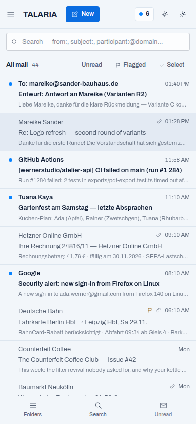
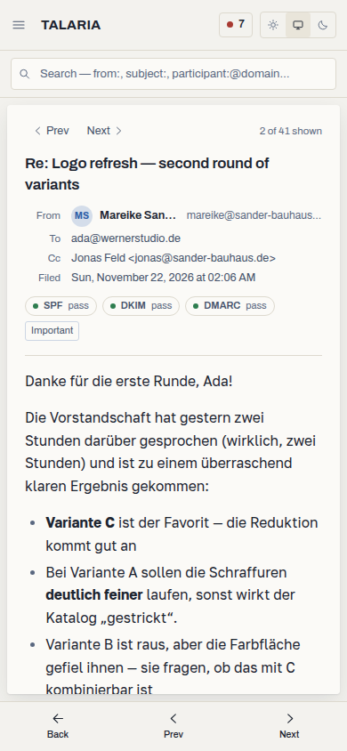

# Talaria

**An unofficial web client for Thunderbird.** A PWA webmail UI on
top of the [commonpost](https://github.com/commonpost/thunderbird-mcp) MCP
addon: your mail, natively rendered in any browser, on desktop and phone.

Talaria is for people who run Thunderbird as their mail hub and want to
triage it from anywhere — the same folders, threads and contacts, but as a
fast web app instead of a remote-desktop session. You can read, search,
organize (read/flag/move) and compose **drafts** — but you can never send
or delete from here: those tools are disabled server-side in the addon, and
the UI has no affordances for them at all. Sending stays in Thunderbird or
on your phone.

| Desktop (1440×900) | Phone — list | Phone — reader |
| --- | --- | --- |
|  |  |  |

*(Screenshots use the built-in demo backend — all data shown is fictional.)*

## How it works

```
browser (Talaria PWA)
   │ HTTPS, behind your authenticating proxy
   ▼
sidecar  (Node 22 + Fastify, this repo: sidecar/)
   │  serves the built SPA + PWA assets
   │  POST /api/tools/call  — JSON-RPC proxy to the addon (token stays here)
   │  GET  /events          — SSE: unread-count changes (polling, 60 s)
   │  POST /push/*          — VAPID web push for new mail
   ▼ HTTP, loopback / private network only
Thunderbird (desktop) + commonpost addon
   │  the addon's experiment-API server: search, threads, contacts, calendar
   ▼
your IMAP / SMTP accounts — exactly as Thunderbird sees them
```

Thunderbird stays the backend: its folders, its filters, its indexes, its
credentials. Talaria renders what the commonpost addon exposes — nothing
more, nothing less. The SPA also ships an in-memory **demo backend** with
fictional data, so you can develop and demo the whole UI without a
Thunderbird anywhere near it (`VITE_BACKEND=mock`).

## Prerequisites

- **Thunderbird 140 ESR or newer** — the addon is an unsigned experiment
  addon; ESR pinning is the supported posture.
- **commonpost v0.26.1 or newer** with the HTTP server enabled and a
  **stable token** configured (addon preference
  `extensions.commonpost-mcp.stableAuthToken`). See the addon's README:
  <https://github.com/commonpost/thunderbird-mcp>
- **Node.js 22** for the sidecar, and for building the SPA.
- An authenticating reverse proxy in front of the sidecar — Cloudflare
  Access, Authelia, oauth2-proxy, or a private network you trust. The
  sidecar has **no application-level authentication** by design.

## Quickstart

**With Docker (recommended)** — the image contains the sidecar and the
built SPA:

```sh
echo "COMMONPOST_MCP_TOKEN=<the addon's stable token>" >> .env
docker compose -f sidecar/compose.example.yaml up -d talaria
```

Generate VAPID keys once with `npx web-push generate-vapid-keys` and add
`TALARIA_VAPID_PUBLIC_KEY` / `TALARIA_VAPID_PRIVATE_KEY` to `.env` for web
push (optional — push is disabled without them). Then put the sidecar
behind your authenticating proxy and open it from a desktop or phone
browser. `docker compose pull talaria` updates to the latest build.

**From source** (Node.js 22):

```sh
# 1. Build the SPA (writes straight into sidecar/public/)
cd spa
npm ci
npm run build

# 2. Run the sidecar
cd ../sidecar
npm ci
COMMONPOST_MCP_TOKEN=<the addon's stable token> \
TALARIA_VAPID_PUBLIC_KEY=<public key> \
TALARIA_VAPID_PRIVATE_KEY=<private key> \
npm start                                # listens on 0.0.0.0:8942
```

Environment contract (all sidecar env vars documented in
[`sidecar/README.md`](sidecar/README.md)):

| Var | Meaning |
| --- | --- |
| `COMMONPOST_MCP_TOKEN` | **required** — the addon's stable token; the sidecar refuses to start without it |
| `TALARIA_VAPID_PUBLIC_KEY` / `TALARIA_VAPID_PRIVATE_KEY` | VAPID identity for web push (private key never leaves the process) |
| `PORT` | listen port (default `8942`) |
| `COMMONPOST_PORTS` | addon probe/failover range (default `8780-8789`) |

## Features

- **Unified view across accounts** — all accounts in one rail, all folders
  with unread tallies, one live unread folio; hide accounts you don't need.
- **Fast boot** — one prewarmed bootstrap call plus a localStorage snapshot:
  first mail row in under a second, repeat visits paint instantly.
- **Organize** — mark read/unread and flag (single or batch), move entries
  to any folder (with inline folder creation), mark-as-read-on-open.
- **Drafts composer** — reply / reply-all / forward / new, rich-text
  editing, recipient chips with address-book autocomplete, autosave, and
  discard-to-Trash. Drafts only: **there is no Send button** — sending
  happens in Thunderbird or on your phone. Reply/forward drafts are
  composed client-side (the addon's own reply/forward draft tools hang on
  IMAP — an upstream bug this project refuses to trigger), so their quotes
  live in the draft body; draft threading headers are not set until the
  addon fixes those tools.
- **Search operators** — `from:`, `to:`, `cc:`, `subject:`,
  `participant:@domain`, plus free text; unread/flagged filters, per-account
  or per-folder scope, and client-side saved searches.
- **Keyboard-driven** — `j/k` to move, `x` to select, `m` to move, `c` to
  compose, `g`-chords to jump between views and folders, `?` for the map.
- **Threads** — the conversation renders in the reader (cross-folder via
  `threadOf`), with per-message SPF/DKIM/DMARC seal pills.
- **Attachments & export** — per-attachment download and exact `.eml`
  export, extracted client-side from the RFC 822 source; print stylesheet
  for a clean paper record.
- **Contacts** — address-book search, paged results, contact cards, and
  "show their mail" integration.
- **Agenda** — docked "next 7 days" rail widget plus a full agenda page
  (calendars, expanded recurring events, open tasks badge).
- **Web push** — self-hosted VAPID notifications on unread-count change; no
  third-party push service configuration beyond the browser vendors'.
- **Remote-image consent** — bodies render without remote images; a
  per-message "Load images" consent, with tracking pixels always stripped.
- **Themes & settings** — 37 themes (two Talaria identities + daisyUI
  built-ins) with live switching, density, account-label mode, search
  scope, and privacy defaults on a real settings page.
- **PWA** — installable, offline app shell, standalone on phone home
  screens; responsive from 3-pane desktop down to stacked phone layout.
- **Virtualized message list** — smooth on five-digit-folder corpora;
  paginate or load more.

## Security notes

- **Expose the sidecar only behind an authenticating proxy.** There is no
  application-level auth; the design assumes the proxy is the gate.
- **The commonpost token never reaches the browser.** It lives in the
  sidecar process and is attached to upstream calls server-side.
- **No send, no delete.** `sendMail` and every deletion tool are disabled
  in the addon config — Talaria composes drafts only, and organize actions
  (read/flag/move/folder-create) are the full write surface. The composer
  has no Send button, asserted in the regression harnesses.
- **Remote images in bodies are stripped by default** (DOMPurify) — no
  tracking pixels on your readers. A per-message "Load images" consent
  exists; 2×2 tracking pixels are stripped even when you consent.
- Attachment downloads and `.eml` export are extracted client-side from the
  message source your sidecar already proxies — bytes never pass through a
  third party.
- Keep the addon's HTTP server off public interfaces; the sidecar should be
  the only reachable hop, and the addon itself refuses public listen
  addresses.

## Roadmap

- **Lower-latency live events** — SSE is currently fed by a 60 s unread
  poll; porting the community change-journal approach would cut delivery to
  seconds without touching the frontend contract (SSE stays).
- **A scoped search fast path** — typed queries currently walk the full
  corpus; folder-first typing would cut latency further.
- **Push polish** — end-to-end tests on real installed PWAs (desktop and
  phone) on a production origin.

## Status: alpha, works on our machine

This is a young single-maintainer project, built against one real
deployment. It works there, on desktop and phone, but treat it as an alpha:
API surface = whatever the commonpost addon exposes, behavior may change,
and there are certainly rough edges. Issues and PRs are welcome — see
[CONTRIBUTING.md](CONTRIBUTING.md).

## Acknowledgements

- **[commonpost/thunderbird-mcp](https://github.com/commonpost/thunderbird-mcp)**
  — the backend addon this whole thing stands on, and the community
  continuation of TKasperczyk's thunderbird-mcp.
- **[thunderbird/stormbox](https://github.com/thunderbird/stormbox)** —
  Mozilla's own Thundermail webmail; a design-language reference (no code
  reused).
- UX and architecture patterns studied (observation, not copying) from
  **Bulwark**, **plMail**, **Gofer** and **root-fr/jmap-webmail** — the
  client/server interface seam in `spa/src/api/` follows the Bulwark
  pattern.

## License & trademark notice

[MPL-2.0](LICENSE) — file-level copyleft, Mozilla-native.

**Talaria is an independent project. It is not affiliated with, endorsed by,
or connected to Mozilla, the Thunderbird project, or the commonpost
project. "Thunderbird" and the Thunderbird logos are trademarks of the
Mozilla Foundation; "Talaria" is an unofficial fan-made client and does not
claim any association with them.**
